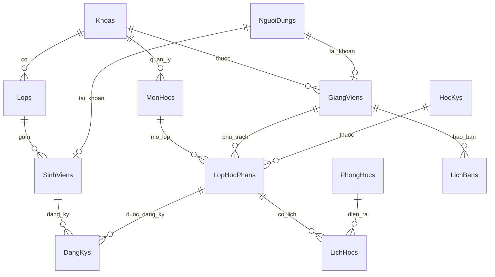

# Cơ sở dữ liệu – Hệ thống Quản lý lịch học

Hệ quản trị: **Microsoft SQL Server** (2016 SP1 trở lên, LocalDB / Express / Developer đều được).

| Tệp | Chức năng |
|---|---|
| `tao_csdl.sql` | Tạo CSDL `QuanLyLichHoc`: 13 bảng, khóa chính/ngoại, ràng buộc CHECK/UNIQUE, chỉ mục, 4 view báo cáo, 3 thủ tục. Chạy lại không mất dữ liệu. |
| `du_lieu_mau.sql` | Nạp dữ liệu mẫu (2 khoa, 3 lớp, 2 học kỳ, 8 phòng, 8 môn, 5 giảng viên, 20 sinh viên, 13 lớp học phần, 13 buổi học, 65 lượt đăng ký, 27 tài khoản). Chạy lại sẽ tự bỏ qua. |
| `xoa_csdl.sql` | Xóa toàn bộ CSDL để làm lại từ đầu (không thể hoàn tác). |

## Cách chạy
**SSMS / Azure Data Studio:** mở `tao_csdl.sql` → Execute (F5); sau đó mở `du_lieu_mau.sql` → Execute.

**Dòng lệnh (sqlcmd):**
```bash
sqlcmd -S "(localdb)\MSSQLLocalDB" -i tao_csdl.sql
sqlcmd -S "(localdb)\MSSQLLocalDB" -i du_lieu_mau.sql
```

## Kết nối ứng dụng với CSDL vừa tạo
Sửa `appsettings.json`:
```json
"Database": { "Provider": "SqlServer" },
"ConnectionStrings": {
  "SqlServer": "Server=(localdb)\\MSSQLLocalDB;Database=QuanLyLichHoc;Trusted_Connection=True;TrustServerCertificate=True"
}
```
Với SQL Server Express: `Server=.\\SQLEXPRESS;Database=QuanLyLichHoc;Trusted_Connection=True;TrustServerCertificate=True`.
Với đăng nhập SQL: `Server=localhost;Database=QuanLyLichHoc;User Id=sa;Password=***;TrustServerCertificate=True`.

> Ứng dụng đã khớp với script: khi CSDL đã có bảng, `EnsureCreated` không làm gì, phần nạp dữ liệu mẫu tự bỏ qua vì đã có tài khoản.
> Nếu **không** chạy script, ứng dụng vẫn tự tạo CSDL (SQLite mặc định hoặc SQL Server) khi khởi động.

## Sơ đồ quan hệ


## Ràng buộc quan trọng trong CSDL
- `Thu` 2–8 (8 = Chủ nhật); `TietBatDau` 1–12; `SoTiet` 1–6; `TietBatDau + SoTiet − 1 ≤ 12`; `TuanKetThuc ≥ TuanBatDau`.
- Một buổi học không được kéo dài từ buổi sáng (tiết 1–6) sang buổi chiều (tiết 7–12) (`CK_LichHocs_Buoi`).
- `LoaiPhong` chỉ `LT`/`TH`; `SucChua > 0`; `SoTinChi` 1–10; `SiSoToiDa` 1–500.
- `TrangThai` lớp học phần ∈ {Mở đăng ký, Đóng, Hủy}; `VaiTro` ∈ {Admin, GiaoVu, GiangVien, SinhVien}.
- Mỗi sinh viên đăng ký một lớp học phần tối đa một lần (khóa chính ghép `MaSV + MaLHP`).
- Các ràng buộc phức tạp hơn (trùng phòng, trùng giảng viên, trùng lịch sinh viên, sĩ số) do ứng dụng kiểm tra; thủ tục `sp_KiemTraXungDotLich` cho phép kiểm tra trực tiếp trong SQL.

## View và thủ tục
| Đối tượng | Mô tả |
|---|---|
| `vw_LichHocChiTiet` | Lịch học kèm môn, giảng viên, phòng, học kỳ và giờ bắt đầu/kết thúc thực tế |
| `vw_KhungGioTiet` | Khung giờ 12 tiết (45 phút/tiết; tiết 1–3 = 07:00–09:25) |
| `vw_SiSoLopHocPhan` | Sĩ số hiện tại, sĩ số tối đa, tỷ lệ lấp đầy |
| `vw_ThoiKhoaBieuSinhVien` | Lịch học theo từng sinh viên đã đăng ký |
| `vw_CongSuatPhong` | Công suất sử dụng phòng theo học kỳ |
| `sp_ThoiKhoaBieuSinhVien` | `EXEC dbo.sp_ThoiKhoaBieuSinhVien @MaSV = N'SV001', @MaHK = 1, @Tuan = 7;` |
| `sp_KiemTraXungDotLich` | Không trả dòng nào = không xung đột |
| `sp_ThongKeHocKy` | `EXEC dbo.sp_ThongKeHocKy @MaHK = 1;` |

Ví dụ truy vấn:
```sql
SELECT * FROM dbo.vw_SiSoLopHocPhan WHERE MaHK = 1 ORDER BY MaLHP;
SELECT * FROM dbo.vw_CongSuatPhong WHERE MaHK = 1 ORDER BY CongSuat DESC;
EXEC dbo.sp_KiemTraXungDotLich @MaLHP = N'LHP01', @MaPhong = 5, @Thu = 2, @TietBatDau = 2, @SoTiet = 2, @TuanBatDau = 1, @TuanKetThuc = 15;
```

## Tài khoản mẫu
`admin / Admin@123` · `giaovu / GiaoVu@123` · `gv001…gv005 / GiangVien@123` · `sv001…sv020 / SinhVien@123`
(mật khẩu lưu dạng băm PBKDF2-SHA256 cùng định dạng với ứng dụng).
